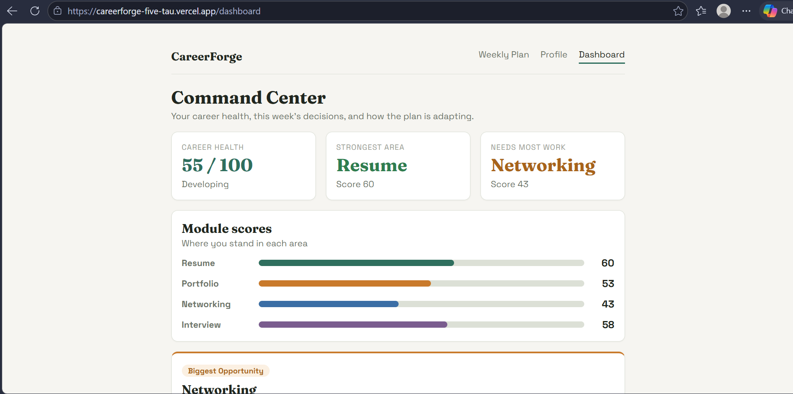
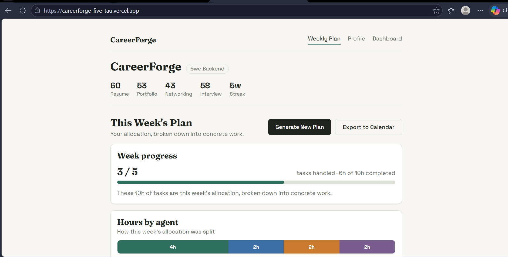
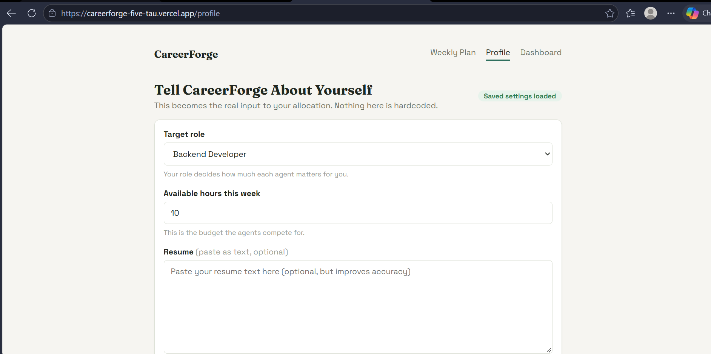
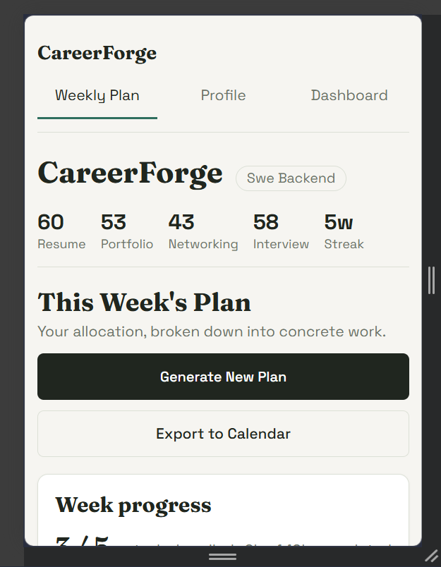

# CareerForge

### Multi-agent career resource allocation and weekly planning

CareerForge treats **career growth as a resource-allocation problem**. Four specialised agents (Skill Building, Networking, Portfolio, Interview Prep) compete for a user's limited weekly hours. A coordinator weighs their bids by the user's target role, turns the winning allocation into concrete tasks, and then **adapts** the next plan as the user completes or ignores work.

> Final-year BCA project, 2026

## Live application

| Component | Link |
| --- | --- |
| Frontend | https://careerforge-five-tau.vercel.app/ |
| Backend API | https://careerforge-backend-lo7f.onrender.com |
| API docs (Swagger) | https://careerforge-backend-lo7f.onrender.com/docs |

> The backend runs on a free hosting tier that sleeps when idle. The first request after a quiet period can take up to a minute; the app shows a "Waking up the server" banner while it starts.

## Screenshots

| Command Center | Weekly Plan |
| --- | --- |
|  |  |

| Profile | Mobile |
| --- | --- |
|  |  |

## What it does

1. **Profile input:** the user chooses a target role and weekly hours, and optionally pastes a resume and a GitHub username.
2. **Analysis:** the resume is checked against a per-role keyword list (whole-word matching), and public GitHub repositories are scanned. Both produce real scores.
3. **Bidding:** each agent computes a bid from the user's current state.
4. **Allocation:** the coordinator multiplies each bid by a role weight and splits the weekly hours.
5. **Plan:** the allocation is turned into concrete weekly tasks, exportable to a calendar (`.ics`).
6. **Feedback:** completing a task raises the relevant domain score; ignoring tasks ends the streak.
7. **Adaptation:** regenerating the plan shows a before/after view, but only when something really changed.
8. **Explainability:** a Career Health Score, a Biggest Opportunity card, a requested-vs-allocated chart and plain-language reasons explain every decision.

## How the allocation works

**Need curve.** Each domain's need falls as its score approaches a target of 70:

```text
need = clamp((70 - score) / 70, 0.05, 1.0)
```

**Agent bids.**

| Agent | Bid |
| --- | --- |
| Networking | need(networking score) |
| Portfolio | need(portfolio score) |
| Interview Prep | average of need(interview score) and the self-rated confidence gap |
| Skill Building | 0.30 x roadmap remaining + 0.10 x need(resume score) + streak momentum (max 0.10) |

**Coordinator.** `combined = bid x role weight`, normalised so shares sum to 1, then converted to whole hours with the largest-remainder method, so the total always equals the available hours.

| Role | Skill Building | Portfolio | Networking | Interview Prep |
| --- | --- | --- | --- | --- |
| Backend Developer | 0.40 | 0.25 | 0.15 | 0.20 |
| Data Analyst | 0.45 | 0.20 | 0.15 | 0.20 |
| Frontend Developer | 0.35 | 0.30 | 0.15 | 0.20 |

**Progress feedback.** Completing a Networking, Portfolio or Interview task adds 3 points to that score (capped at 100). Every 3 completed Skill Building tasks advance the skill roadmap to the next prerequisite-aware skill. Resume score only changes through a real resume analysis.

The bidding logic is deliberately transparent: every number above is visible in the code and explained to the user in the dashboard. The agents are rule-based: no machine-learning model or LLM is used, and adaptation comes from updating the user's scores and skill roadmap.

## Architecture

```text
Profile (role, hours, resume, GitHub)
        |
        v
Analysis (resume score, portfolio score, skill graph)
        |
        v
Four agents -> bids -> Coordinator (role-weighted) -> allocation
                                                        |
                                                        v
                         Weekly plan -> task feedback -> updated state
                                                        |
                                                        v
                              Adaptation (before/after) + Career Health
```

## Tech stack

- **Backend:** Python, FastAPI, Pydantic v2, JSON file storage, GitHub REST API, pytest
- **Frontend:** React, Vite, React Router, plain CSS with a small design-token system
- **Hosting:** Render (backend), Vercel (frontend)

## Project structure

```text
careerforge/
+-- backend/
|   +-- app/
|   |   +-- agents/      four agents, calibration, coordinator, role weights
|   |   +-- analysis/    resume analyzer, GitHub scanner, skill graph
|   |   +-- export/      calendar (.ics) export
|   |   +-- insights/    career health, explanations, adaptation
|   |   +-- plan/        plan generator and store
|   |   +-- state/       state vector and state builder
|   |   +-- tracker/     progress tracker, rewards
|   |   +-- main.py      FastAPI app
|   +-- scripts/         probes and demo_reset.py
|   +-- tests/
+-- frontend/
|   +-- src/
|       +-- api/         API client
|       +-- components/  agent, allocation, adaptation and plan components
|       +-- pages/       Weekly Plan, Profile, Command Center
|       +-- ui/          theme primitives and loading/empty/error states
+-- docs/                screenshots and demo script
+-- README.md
```

## API highlights

```text
GET  /                      health check
GET  /state                 current state vector
GET  /bids                  the four agent bids
GET  /allocate              coordinator allocation
POST /generate-plan         build and save the weekly plan
GET  /plan                  current plan (404 if none yet)
GET  /export-calendar       .ics download
POST /tasks/{id}/complete   mark a task done
POST /tasks/{id}/ignore     mark a task ignored
GET  /rewards               reward log
POST /update-profile        set role and hours
POST /analyze-resume        resume analysis, updates resume score
POST /analyze-portfolio     GitHub scan, updates portfolio score
GET  /skill-graph/{role}    role skill chain
GET  /skill-progress        completed and next skills
GET  /dashboard             health, bids, allocation, explanations, adaptation
POST /reset                 restore the baseline state, delete the plan and reward log
```

## Running locally

**Backend** (Windows):

```bash
cd backend
python -m venv venv
venv\Scripts\activate
pip install -r requirements.txt
uvicorn app.main:app --reload
```

Backend: http://127.0.0.1:8000 (docs at /docs)

**Frontend** (second terminal):

```bash
cd frontend
npm install
npm run dev
```

Frontend: http://localhost:5173

> Use `localhost`, not `127.0.0.1`, for the frontend; the backend's CORS list allows `localhost:5173`.

For a deployed frontend, set `VITE_API_BASE_URL` to the backend URL.

## Testing

```bash
cd backend
python -m pytest
```

31 automated tests cover the calibrated bidding and allocation (progress in a domain lowers that domain's share, hours always sum to the budget), adaptation tracking, career health and explanations.

## Demo

```bash
python backend\scripts\demo_reset.py              # warm up the live backend and reset to baseline
python backend\scripts\demo_reset.py --warmup-only
python backend\scripts\demo_reset.py --local
```

A 3-minute walkthrough is in [docs/DEMO_SCRIPT.md](docs/DEMO_SCRIPT.md).

## Limitations

- State is stored in JSON files for a single user; there is no authentication or database.
- The free hosting tier resets file storage and sleeps when idle.
- Resumes are pasted as text (no PDF upload); GitHub scanning uses the public API and can be rate limited.
- Three target roles are supported.

## Future work

User accounts and a database with history, PDF resume upload, more roles, per-agent ignore tracking, and calendar integration beyond `.ics` export.

## Team

Built by Arfa Munazir (lead developer) with teammates Anam Khanum and Arfa Taj, as a final-year BCA project, 2026.