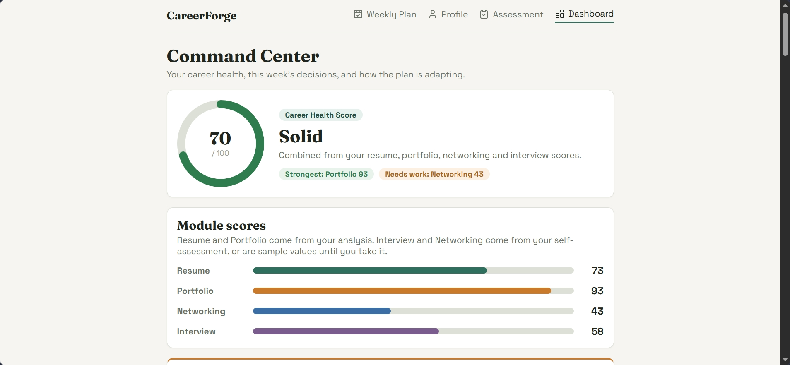
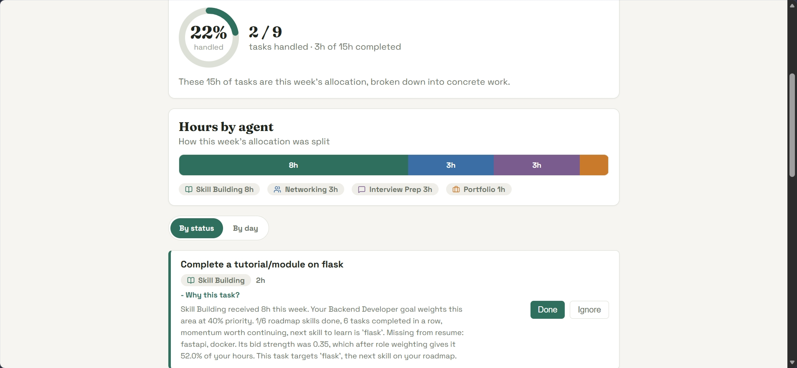
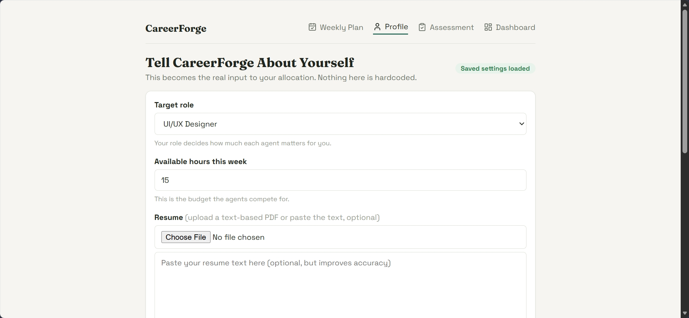
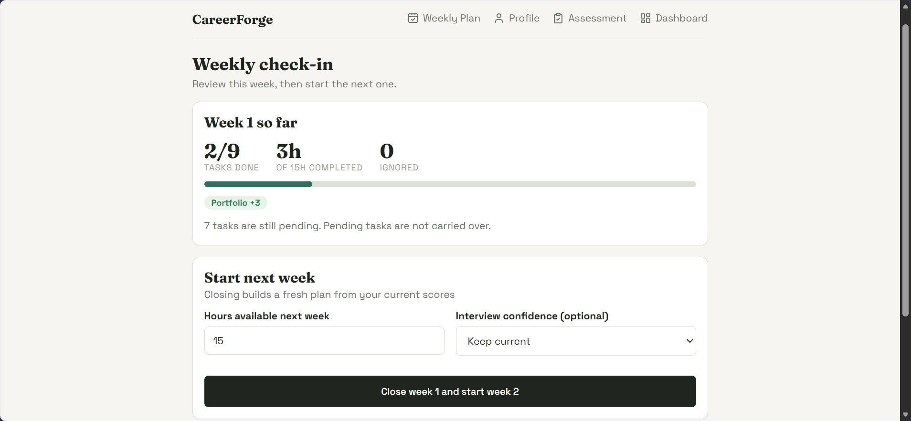
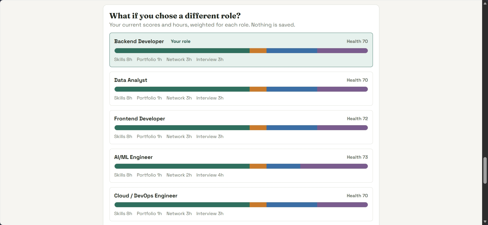
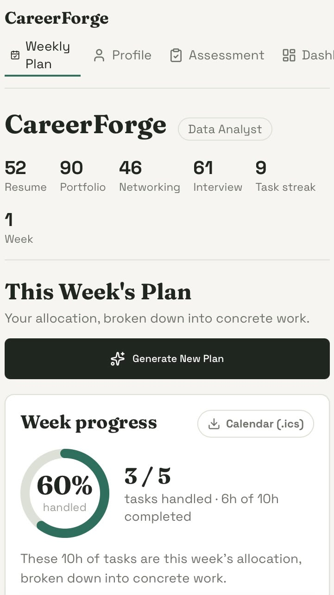

# CareerForge

### Multi-agent career resource allocation and weekly planning

CareerForge treats **career growth as a resource-allocation problem**. Four specialised agents (Skill Building, Networking, Portfolio, Interview Prep) compete for a user's limited weekly hours. A coordinator weighs their bids by the user's target role and by how well the user follows through on each agent's tasks, turns the result into concrete tasks, and then **adapts** the next plan as the user completes or ignores work.

> Final-year BCA project, 2026

## Live application

| Component | Link |
| --- | --- |
| Frontend | https://careerforge-five-tau.vercel.app/ |
| Backend API | https://careerforge-backend-lo7f.onrender.com |
| API docs (Swagger) | https://careerforge-backend-lo7f.onrender.com/docs |

> The backend runs on a free hosting tier that sleeps when idle. The first request after a quiet period can take up to a minute; the app shows a "Waking up the server" banner while it starts.

## Screenshots

| Command Center | Weekly Plan |
| --- | --- |
|  |  |

| Profile | Weekly check-in |
| --- | --- |
|  |  |

| Role simulator | Mobile |
| --- | --- |
|  |  |

## What it does

1. **Profile input:** the user picks one of ten target roles and a weekly hour budget, and optionally adds a resume (pasted, or a text-based PDF up to 2 MB that is read in memory and never stored) and a portfolio: a GitHub username for technical roles, or self-reported portfolio evidence (links, case studies, a short checklist) for design, business, marketing and finance roles.
2. **Analysis:** the resume is checked against a per-role keyword list (whole-word matching), public GitHub repositories are scanned, and portfolio evidence is scored. Every finding is shown on the Command Center.
3. **Self-assessment:** an optional role-specific interview quiz (6 questions), a networking check (4 questions) and a confidence rating replace the sample values with the user's own answers.
4. **Bidding:** each agent computes a bid from the user's current scores.
5. **Allocation:** the coordinator multiplies each bid by the role weight and a follow-through weight, then converts the shares into whole hours.
6. **Plan:** the allocation becomes concrete weekly tasks (portfolio and interview tasks are role-specific). Every task can explain why it is in the plan, and the plan exports to a calendar (`.ics`).
7. **Feedback:** completing a task raises the matching domain score. Ignoring tasks ends the streak and, if it keeps happening, trims that agent's weight.
8. **Adaptation:** the dashboard shows score progress, how each agent's share of the week would shift, and how the hours moved between plans, with plain-language reasons.
9. **Weekly check-in:** closing a week logs the results (the last 12 weeks are kept), rolls the week forward and builds the next plan.
10. **What-if simulator:** shows how the same scores and hours would be planned under each of the ten roles, without saving anything.

## Supported roles

| Role | Portfolio evidence | Skill Building | Portfolio | Networking | Interview Prep |
| --- | --- | --- | --- | --- | --- |
| Backend Developer | GitHub scan | 0.40 | 0.25 | 0.15 | 0.20 |
| Data Analyst | GitHub scan | 0.45 | 0.20 | 0.15 | 0.20 |
| Frontend Developer | GitHub scan | 0.35 | 0.30 | 0.15 | 0.20 |
| AI/ML Engineer | GitHub scan | 0.40 | 0.30 | 0.10 | 0.20 |
| Cloud / DevOps Engineer | GitHub scan | 0.40 | 0.25 | 0.15 | 0.20 |
| Cybersecurity Analyst | GitHub scan | 0.40 | 0.20 | 0.20 | 0.20 |
| UI/UX Designer | Self-reported evidence | 0.35 | 0.35 | 0.15 | 0.15 |
| Business Analyst | Self-reported evidence | 0.40 | 0.15 | 0.20 | 0.25 |
| Digital Marketing Specialist | Self-reported evidence | 0.35 | 0.30 | 0.20 | 0.15 |
| Finance Analyst | Self-reported evidence | 0.45 | 0.10 | 0.20 | 0.25 |

Every role has its own skill-dependency chain, resume keywords, interview quiz and role-specific portfolio and interview tasks.

## How the allocation works

**Need curve.** Each domain's need falls as its score approaches a target of 70:

```text
need = clamp((70 - score) / 70, 0.05, 1.0)
```

**Agent bids.**

| Agent | Bid |
| --- | --- |
| Networking | need(networking score) |
| Portfolio | need(portfolio score) |
| Interview Prep | average of need(interview score) and the self-rated confidence gap |
| Skill Building | 0.30 x roadmap remaining + 0.10 x need(resume score) + streak momentum (max 0.10) |

**Coordinator.** `combined = bid x role weight x follow-through weight`, normalised so shares sum to 1, then converted to whole hours with the largest-remainder method, so the total always equals the available hours.

**Follow-through weight.** The last 20 completed or ignored tasks of each agent give a smoothed follow-through rate (a Beta(1, 1) prior, so one outcome never swings the plan). Agents whose tasks keep being ignored get a weight between 0.7 and 1.0, so the plan drifts toward what the user actually does while every agent keeps a share. Completing tasks does not boost an agent: need still decides priorities.

**Progress feedback.** Completing a Networking, Portfolio or Interview task adds 3 points to that score (capped at 100). Every 3 completed Skill Building tasks advance the skill roadmap to the next prerequisite-aware skill. The resume score only changes through a resume analysis.

**Measured inputs.**

| Input | How it is scored |
| --- | --- |
| Resume | Keyword coverage for the role (50%), expected sections (30%), action words (20%) |
| GitHub | Original repository count (60%) and share of repos with a description (40%) |
| Portfolio evidence | Links 25, case studies 40, measurable results 15, process explained 10, recent work 10. Links are checked for format and platform and are never opened |
| Interview quiz | Correct answers out of 6 |
| Networking check | Four answers scored 0 to 3 each |

**Is it AI?** The agents are rule-based: no machine-learning model or LLM is used. The system is a transparent multi-agent allocator, every number above is visible in the code and explained to the user, and the adaptation comes from updating the user's scores, skill roadmap and per-agent follow-through.

## Architecture

```text
Profile (role, hours, resume or PDF, GitHub or portfolio evidence)
        |
        v
Analysis: resume score, portfolio score, self-assessment, skill graph
        |
        v
Four agents -> bids -> Coordinator (role weight x follow-through) -> allocation
                                                                   |
                                                                   v
                    Weekly plan with reasons -> task feedback -> updated state
                                                                   |
                                                                   v
          Adaptation, learning and Career Health -> weekly check-in -> next plan
```

## Tech stack

- **Backend:** Python, FastAPI, Pydantic v2, JSON file storage, GitHub REST API, pypdf, pytest
- **Frontend:** React, Vite, React Router, lucide-react icons, plain CSS with a small design-token system
- **Hosting:** Render (backend), Vercel (frontend, with an SPA rewrite so deep links work)

## Project structure

```text
careerforge/
+-- backend/
|   +-- app/
|   |   +-- agents/      four agents, calibration, coordinator, role weights, follow-through learning
|   |   +-- analysis/    resume analyzer, PDF text, GitHub scanner, portfolio evidence, self-assessment, skill graph
|   |   +-- export/      calendar (.ics) export
|   |   +-- insights/    career health, explanations, adaptation, weekly check-in, role simulator
|   |   +-- plan/        plan generator, role-specific tasks, plan store
|   |   +-- state/       state vector and state builder
|   |   +-- tracker/     progress tracker, rewards
|   |   +-- roles.py     the ten roles and their portfolio mode
|   |   +-- main.py      FastAPI app
|   +-- scripts/         demo_reset.py, smoke_test.py and the calibration probes
|   +-- tests/
+-- frontend/
|   +-- src/
|       +-- api/         API clients
|       +-- components/  agent, allocation, adaptation, analysis, assessment and simulator components
|       +-- pages/       Weekly Plan, Weekly check-in, Profile, Assessment, Command Center
|       +-- ui/          theme primitives and loading, empty and error states
+-- docs/                API contract, demo script, pre-demo checklist, screenshots
+-- README.md
```

## API highlights

```text
GET  /                          health check
GET  /state                     current state vector
POST /reset                     restore the baseline state, delete the plan and reward log
POST /update-profile            set role and hours
GET  /roles                     the ten roles and their portfolio mode
POST /analyze-resume            resume analysis, updates the resume score
POST /extract-resume-text       read the text of a PDF resume (not stored)
POST /analyze-portfolio         GitHub scan, updates the portfolio score
POST /portfolio-evidence        portfolio evidence score for non-GitHub roles
GET  /self-assessment/questions role quiz and networking questions (no answers)
POST /self-assessment           score the quiz, networking check and confidence
GET  /bids                      the four agent bids
GET  /allocate                  coordinator allocation
POST /generate-plan             build and save the weekly plan
GET  /plan                      current plan (404 if none yet)
GET  /export-calendar           .ics download
POST /tasks/{id}/complete       mark a task done
POST /tasks/{id}/ignore         mark a task ignored
GET  /week-summary              this week's results so far
POST /next-week                 close the week and build the next plan
GET  /rewards                   reward log
GET  /dashboard                 health, bids, allocation, shares, explanations, adaptation, learning
GET  /simulate-roles            read-only what-if across all roles
GET  /skill-graph/{role}        role skill chain
GET  /skill-progress            completed and next skills
```

The full request and response shapes are in [docs/api_contract.md](docs/api_contract.md).

## Running locally

**Backend** (Windows):

```bash
cd backend
python -m venv venv
venv\Scripts\activate
pip install -r requirements.txt
uvicorn app.main:app --reload
```

Backend: http://127.0.0.1:8000 (docs at /docs)

**Frontend** (second terminal):

```bash
cd frontend
npm install
npm run dev
```

Frontend: http://localhost:5173

> Use `localhost`, not `127.0.0.1`, for the frontend; the backend's CORS list allows `localhost:5173`.

For a deployed frontend, set `VITE_API_BASE_URL` to the backend URL.

## Testing

```bash
cd backend
pip install -r requirements-dev.txt
python -m pytest
```

178 automated tests cover the calibrated bidding and allocation, adaptation and share shifts, follow-through learning, the weekly check-in, assessment scoring, the configuration of all ten roles, PDF text extraction (with generated PDFs), portfolio-evidence scoring, input validation and the full API flow. The API tests run against temporary copies of the state, plan and reward files, and a check at the end of every run fails if a test touched the real ones.

## Demo and operations

```bash
python backend\scripts\demo_reset.py                # warm up the live backend and reset to baseline
python backend\scripts\smoke_test.py                # end-to-end check of the live backend (resets it)
python backend\scripts\smoke_test.py --local        # the same against http://127.0.0.1:8000
```

- A timed walkthrough is in [docs/DEMO_SCRIPT.md](docs/DEMO_SCRIPT.md).
- The pre-demo steps are in [docs/PRE_DEMO_CHECKLIST.md](docs/PRE_DEMO_CHECKLIST.md).

## Limitations

- **One shared user.** State is a single JSON store, there are no accounts, and anyone with the link sees and changes the same data. `POST /reset` is public.
- **Free hosting.** The backend sleeps when idle, and its file storage can reset on a restart or redeploy.
- **Rule-based, not machine learning.** There is no model or LLM; adaptation is transparent arithmetic over the user's inputs.
- **Simple resume analysis.** Keyword matching against a per-role list, for text-based PDFs only (no scans, no Word files).
- **GitHub scan.** It uses the unauthenticated public API, which is rate limited, and checks repository count and descriptions, not commits or READMEs.
- **Self-reported inputs.** Portfolio evidence and the assessment are self-reported, links are never opened, and the quiz is six basic questions per role.
- **Activity-based scores.** Completing a task adds 3 points to a domain score; that measures activity, not proven skill.
- **Planning.** Calendar export uses fixed 6 PM slots and `.ics` only, and pending tasks are not carried over when a week is closed.

## Future work

Accounts and per-user storage in a durable database, opening and verifying portfolio links, commit and README analysis for GitHub, larger quiz banks and mock interviews, Word resume upload, Google Calendar integration, and an optional boost (not only a penalty) in the follow-through weight.

## Team

Built by Arfa Munazir (lead developer) with teammates Anam Khanum and Arfa Taj, as a final-year BCA project, 2026.